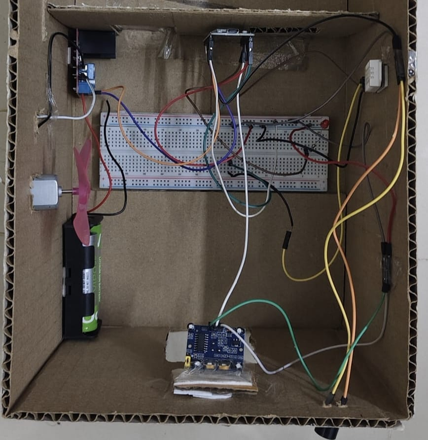
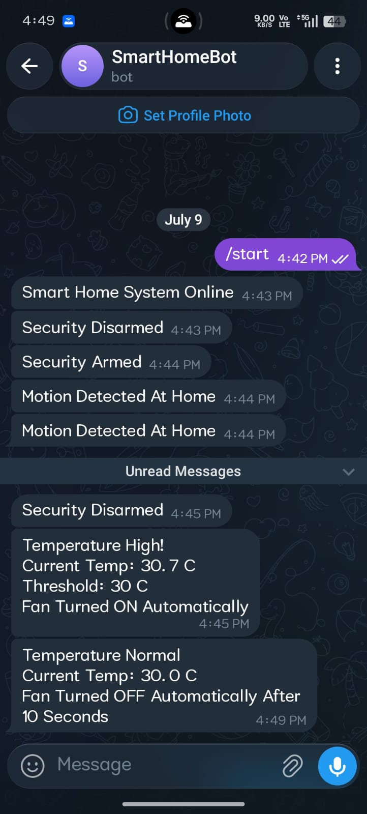

# Smart Home Automation and Security System

An ESP32-based smart home system combining voice-controlled appliances, temperature-based fan automation, and motion detection with Telegram security alerts.

## Features

- **Voice Control:** Control the light and fan using Google Assistant through Sinric Pro.

- **Temperature-Based Automation:** Automatically turns the fan on when the temperature exceeds 32 degrees C using a DHT22 sensor.

- **Security Mode:** Monitor movement using a PIR sensor when security mode is enabled.

- **Motion Alerts:** Activate a buzzer and send Telegram notifications when motion is detected in security mode.

- **Remote Notifications:** Receive system status and alerts through Telegram.

## Hardware Components

- ESP32 DevKit V1

- PIR motion sensor

- DHT22 temperature sensor

- LED

- Active buzzer

- L298N motor driver

- DC motor (fan prototype)

- Breadboard and jumper wires

## Technologies Used

- C/C++ with Arduino IDE

- ESP32 Arduino Core

- Sinric Pro

- Google Assistant

- Telegram Bot API

## Project Gallery

### Hardware Prototype

### Telegram Alert

## Setup

1\. Install the Arduino IDE and configure ESP32 board support.

2\. Install the required libraries, including SinricPro and the DHT sensor library.

3\. Configure your Wi-Fi, Telegram, and Sinric Pro credentials in your private local copy of the sketch.

4\. Configure the device IDs to match your Sinric Pro devices.

5\. Connect the hardware and upload the sketch to your ESP32.

> **Security:** Never publish Wi-Fi passwords, Telegram bot tokens, or Sinric Pro secrets in a public repository.

## Future Improvements

- Add energy monitoring and power-consumption analysis.

- Develop a mobile monitoring interface.

- Expand automation with additional sensors and devices.

## License

For learning and educational purposes.

